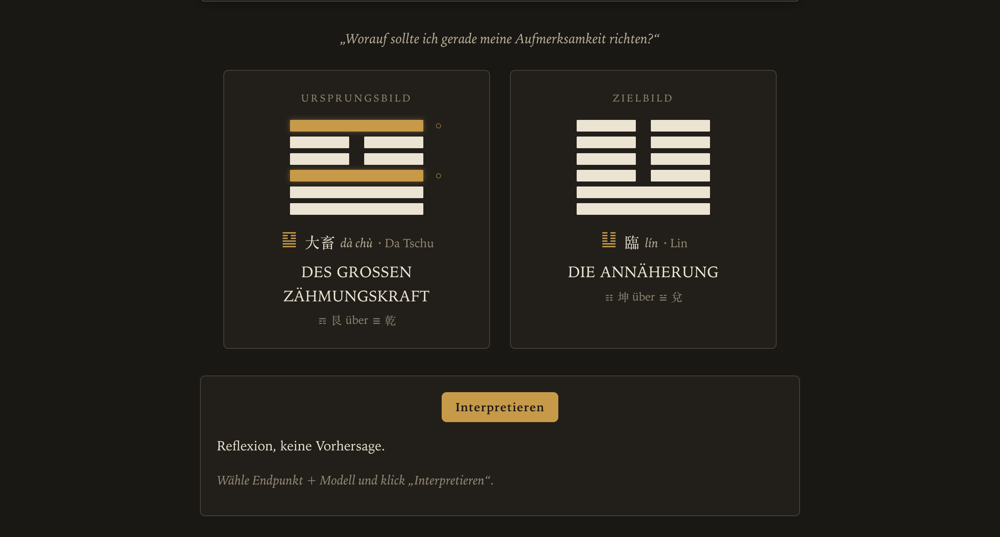
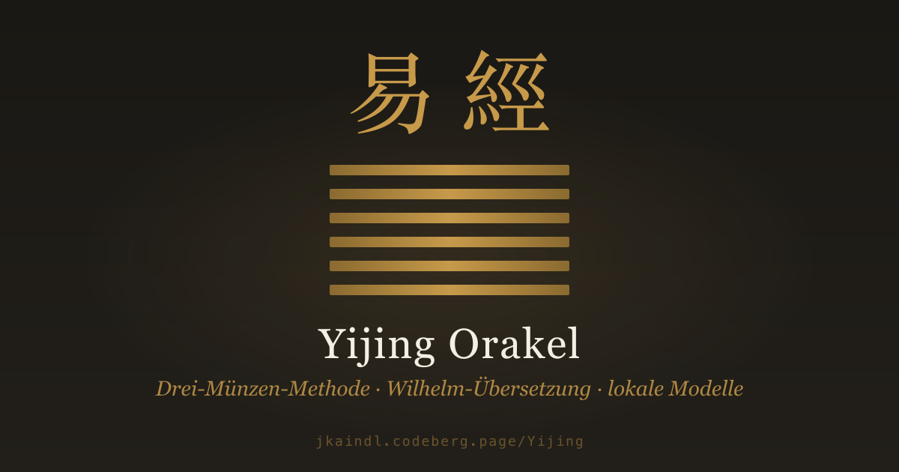
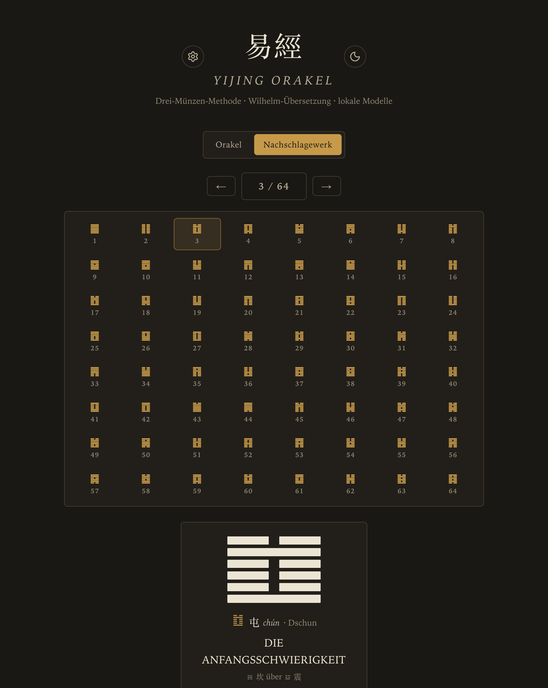
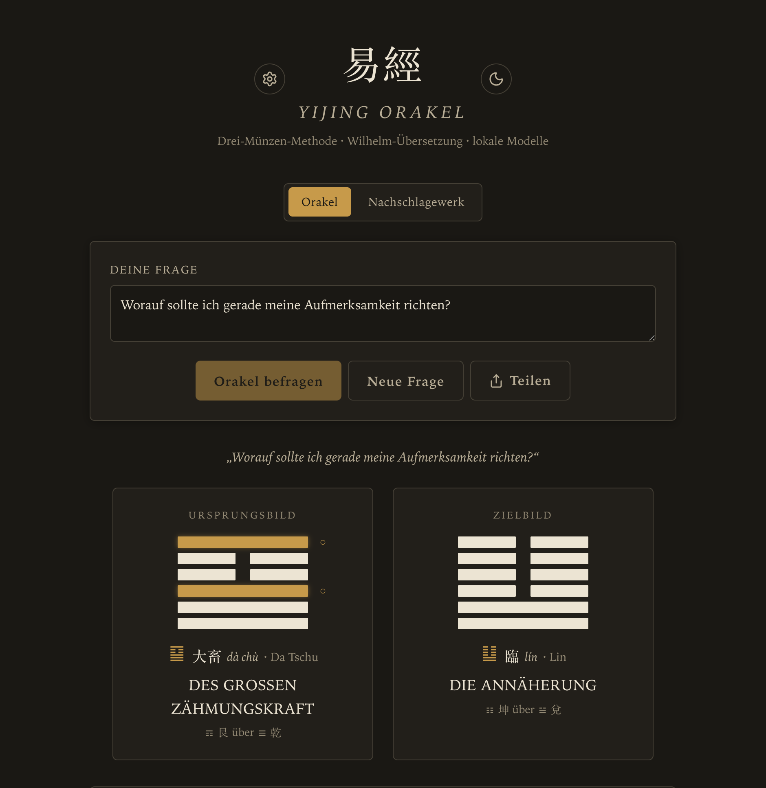
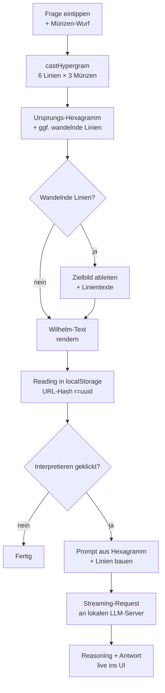

[🇬🇧 English](README.md) · **🇩🇪 Deutsch**

# Yijing Orakel

[](LICENSE)
[](LICENSE-DOCS)
[](https://git.jkaindl.de/jkaindl/Yijing/releases)
[](https://git.jkaindl.de/jkaindl/Yijing/commits/branch/main)
[](docs/MACOS-APP.md)
[](docs/IOS-APP.md)
[](docs/IOS-APP.md)
[](https://apps.apple.com/app/yijing-i-ching/id6780668644)
[](https://pages.jkaindl.de/yijing/)
[](#warum-keine-build-pipeline)

<p align="center">
  
  <br><em>Eine Lesung im Browser — Ursprungs- und Zielbild, Wandlungslinien markiert.</em>
</p>

Ein schlankes I-Ging-Orakel als Static-Site mit Wilhelm-Übersetzung und
optionaler KI-Deutung über lokale LLM-Server (Ollama, MLX, LM Studio,
vLLM, OpenClaw). Drei-Münzen-Methode, vollständige Wilhelm-Texte
inklusive aller wandelnden Linien, chinesisches Schrift­zeichen mit
Pīnyīn, Trigramme mit Stammdaten. **Zweisprachig Deutsch / English** —
UI und Hexagramm-Texte umschaltbar (Englisch ist eine eigene
Übersetzung des Wilhelm-Originals, im Wilhelm-Stil gehalten, klassische
I-Ching-Vokabeln). Vanilla JavaScript, kein Build-Step, kein Backend,
offline-fähig als PWA.

Neben der Static-Site und der älteren macOS-App gibt es jetzt eine
**universelle native App für iPhone, iPad und Apple Watch**, [live im App
Store](https://apps.apple.com/app/yijing-i-ching/id6780668644). Sie zeigt
dieselbe Web-App in einer WebView und ergänzt Apple-Plattform-Extras:
**KI-Deutung on-device** (Apple Foundation Models),
**Meditationsbild-Generierung on-device** (Apple Image Playground), ein
**Tages-Hexagramm-Widget für Home- und Sperrbildschirm** sowie eine
**eigenständige Apple-Watch-App mit Komplikation**. Dasselbe Projekt baut
auch via Mac Catalyst für den Mac — der langfristige Mac-Weg, noch nicht Teil
des veröffentlichten Listings.

<p align="center">
  <a href="https://pages.jkaindl.de/yijing/">
    
  </a>
</p>

[](https://apps.apple.com/app/yijing-i-ching/id6780668644)
[](https://git.jkaindl.de/jkaindl/Yijing/releases/download/v1.5.0/Yijing.dmg)
[](https://pages.jkaindl.de/yijing/)

Disk-Image öffnen, „Yijing" in den Programme-Ordner ziehen — fertig.
Die App ist **Developer-ID-signiert und Apple-notarisiert** und startet
sofort, ohne Gatekeeper-Warnung. Hintergrund und die Signatur-Pipeline:
[`docs/MACOS-APP.md`](docs/MACOS-APP.md).

---

## Inhalt

- [Live-Demo](#live-demo)
- [Verwendung](#verwendung)
- [Als macOS-App](#als-macos-app)
- [Als iOS- / iPadOS- / Mac-(Catalyst-)App](#als-ios---ipados---mac-catalyst-app)
- [Features](#features)
- [Sprache (Deutsch / English)](#sprache-deutsch--english)
- [Lokale LLM-Anbindung](#lokale-llm-anbindung)
- [Wie ein Wurf abläuft](#wie-ein-wurf-abläuft)
- [Drei-Münzen-Methode](#drei-münzen-methode)
- [Verzeichnisstruktur](#verzeichnisstruktur)
- [Dokumentation](#dokumentation)
- [Release-Historie](#release-historie)
- [Mitmachen](#mitmachen)
- [Sicherheit melden](#sicherheit-melden)
- [Lizenz](#lizenz)
- [Quellen](#quellen)
- [Status](#status)

---

## Live-Demo

<https://pages.jkaindl.de/yijing/> — funktioniert ohne lokales
Setup für Hexagramm-Wurf und Wilhelm-Text. Die KI-Deutung erfordert
einen lokal laufenden LLM-Server (Ollama oder MLX), siehe
[Verwendung](#verwendung).

Beim ersten Besuch installiert sich der Service Worker im Hintergrund
— danach läuft die Seite vollständig offline. Über den
„App-installieren"-Knopf des Browsers landet sie als PWA im Dock oder
auf dem Homescreen.

## Verwendung

```bash
git clone https://git.jkaindl.de/jkaindl/Yijing.git yijing
cd yijing
./serve.sh
```

Öffnet `http://localhost:8765/web/index.html` automatisch.

> Voraussetzung: Python 3.9+. Keine npm-Dependencies, kein Build-Step,
> kein Backend.

## Als macOS-App

Für die Weitergabe an Nutzer ohne Terminal-Erfahrung lässt sich das
Orakel als doppelklickbare macOS-App bündeln:

```bash
./scripts/package-macos-app.sh
```

Das erzeugt `dist/Yijing.dmg` — ein Disk-Image, in dem die `Yijing.app`
per Drag & Drop in den Programme-Ordner gezogen wird. Die App zeigt das
Orakel in einem eigenen Fenster, ganz ohne Terminal und ohne Browser.
Voraussetzung zum Bauen: Xcode Command Line Tools
(`xcode-select --install`). Details: [`docs/MACOS-APP.md`](docs/MACOS-APP.md).

## Als iOS- / iPadOS- / Mac-(Catalyst-)App

Die App für iPhone, iPad und Apple Watch ist **live im App Store**:
<https://apps.apple.com/app/yijing-i-ching/id6780668644>. Zum Selberbauen:
Die universelle native Familie (iOS 17 / iPadOS / Mac Catalyst + watchOS
10) liegt unter `scripts/ios-app/`. Es ist ein [XcodeGen](https://github.com/yonaskolb/XcodeGen)-Projekt
— das `.xcodeproj` wird generiert, nicht eingecheckt. Voraussetzungen: das
**vollständige Xcode** (nicht nur die Command Line Tools) und
`brew install xcodegen`. Bauen mit:

```bash
scripts/ios-app/build-ios-app.sh [simulator|catalyst|archive|device|watch]
```

`simulator` (Default) startet im iOS-Simulator, `catalyst` baut die
Mac-App (der langfristige Mac-Weg, der die alte AppKit-App ablösen soll),
`archive` erzeugt ein App-Store-Archiv, `device` baut und installiert auf
einem angeschlossenen iPhone, `watch` zielt auf die watchOS-App. Der Build
bettet das **eingecheckte** `web/` + `data/` ein — also vor dem Bauen
committen. Details pro Target und die Build-Skript-Referenz:
[`scripts/ios-app/README.md`](scripts/ios-app/README.md) und
[`docs/IOS-APP.md`](docs/IOS-APP.md).

Die Versionsstränge sind bewusst getrennt: die macOS-AppKit-DMG läuft auf
der **1.5.x**-Linie, die iOS-/Watch-Familie auf ihrer eigenen
**1.0.x**-Linie — jetzt als v1.0 (Build 5) im App Store erschienen.

## Features

- **Drei-Münzen-Methode** mit korrekter Verteilung (1/8 : 3/8 : 3/8 : 1/8)
- **Ursprungs- und Zielbild** bei wandelnden Linien, mit visueller
  Markierung
- **Wilhelm-Übersetzung** (1924, gemeinfrei): Urteil, Bild, Bedeutung,
  alle sechs Linientexte mit Konfuzius-Kommentar
- **Nachschlagewerk** — alle 64 Hexagramme in King-Wen-Reihenfolge mit
  vollständigem Text und Anmerkungen durchblättern, unabhängig vom Wurf
  (8×8-Übersicht, Vor/Zurück, Deep-Links)
- **Geschlechtsneutrale Fassung als Standard**, per Klick umschaltbar auf
  Wilhelms historischen Wortlaut von 1924 — in beiden Sprachen
- **Chinesisches Schriftzeichen + Pīnyīn** pro Hexagramm
- **Trigramme** mit Familie, Natur, Jahreszeit, Himmelsrichtung,
  Assoziationen
- **Bildmeditation** — atmosphärische Stichworte im Web; in der nativen
  App ein optionales Meditationsbild pro Lesung, vollständig on-device
  über Apple Image Playground generiert
- **Tages-Hexagramm-Widget** (nativ) — Home- und Sperrbildschirm, auf
  iOS / iPadOS / Mac, lädt zur lokalen Mitternacht neu
- **Apple-Watch-App + Komplikation** (nativ) — das Tages-Hexagramm und
  ein voller Drei-Münzen-Wurf am Handgelenk; offline, ohne KI
- **KI-Interpretation** mit Streaming, Reasoning-Steuerung und
  Markdown-Rendering — in der nativen App on-device über Apple Foundation
  Models (privat, offline, ohne Server), mit einem lokalen LLM-Server
  (Ollama, MLX, LM Studio, vLLM, OpenClaw) als plattformübergreifendem Weg
  und Fallback für nicht geeignete Geräte
- **`yijing://`-Deep-Link** (nativ) — öffnet das Nachschlagewerk direkt
  beim jeweiligen Hexagramm aus dem Widget heraus
- **Verlauf** der letzten 20 Würfe in localStorage, einzelne Würfe via
  URL-Hash teilbar und wiederherstellbar
- **Export** als Markdown oder druckfreundliches PDF
- **Offline-fähig** — Service Worker; nach dem ersten Besuch lädt und
  läuft die App ohne Internet. Als PWA installierbar.
- **Theme-Umschalter** — Dark, Light oder automatisch nach
  System­einstellung
- **Tastatur-Bedienung** für Wurf, Reset und Settings

<p align="center">
  
  <br><em>Nachschlagewerk — alle 64 Hexagramme mit vollständigem Text durchblättern, unabhängig vom Wurf.</em>
</p>

## Sprache (Deutsch / English)

Die App startet in der Sprache deines Browsers (`navigator.language`):
`en*` → English, alles andere → Deutsch. Umschaltbar im Settings-Modal
(⚙ → Sprache). Die Auswahl wirkt sofort auf alle UI-Elemente, das
Datumsformat im Verlauf, die Markdown-Export-Header und den Default-
System-Prompt für die KI-Interpretation.

Die englischen Hexagramm-Texte sind eine eigene Übersetzung des
deutschen Wilhelm-Originals (1924, gemeinfrei) im Wilhelm-Stil:
würdevoll, kontemplativ, mit den klassischen I-Ching-Vokabeln aus der
englischen Standardliteratur (the superior man, the great man, the
noble, the abyss, the well, the receptive, the creative …) —
vergleichbar mit Cary F. Baynes' 1950er-Übersetzung, aber in eigenen
Worten. Übersetzt mit Claude Opus 4.7, parallel über acht Subagenten.
Schema und Generierungs-Details: [`docs/DATA.md`](docs/DATA.md#english-variant-datahexagramsenjson).

## Lokale LLM-Anbindung

Klick auf das ⚙-Symbol oben links öffnet das Settings-Modal. Beim ersten
Start probiert die App automatisch die typischen lokalen Endpunkte:

| Server | URL-Beispiel |
|---|---|
| Ollama | `http://localhost:11434` |
| MLX (`mlx_lm.server`) | `http://localhost:8080/v1` |
| LM Studio | `http://localhost:1234/v1` |

Weitere Endpunkte lassen sich manuell hinzufügen.

### CORS

Die Web-App ruft die LLM-Server direkt aus dem Browser auf — beide Seiten
müssen CORS erlauben. Für Ollama auf macOS:

```bash
launchctl setenv OLLAMA_ORIGINS "*"
# Ollama neu starten
```

MLX und LM Studio sind standardmäßig offen. Details und Fehlersuche:
[`docs/LLM.md`](docs/LLM.md#cors-troubleshooting).

## Wie ein Wurf abläuft

<p align="center">
  
  <br><em>Eine gewürfelte Lesung — Ursprungs- und Zielbild, mit den wandelnden Linien markiert.</em>
</p>



Technische Details: [`docs/ARCHITECTURE.md`](docs/ARCHITECTURE.md).

## Drei-Münzen-Methode

Pro Linie drei Münzen (Yin = 0, Yang = 1), Summe + 6 ergibt den
Linienwert:

| Wert | Bedeutung | Wahrscheinlichkeit |
|---|---|---|
| 6 | wandelndes Yin (○) | 1/8 (12,5 %) |
| 7 | festes Yang | 3/8 (37,5 %) |
| 8 | festes Yin | 3/8 (37,5 %) |
| 9 | wandelndes Yang (○) | 1/8 (12,5 %) |

Die Auflösung wandelnder Linien zu einem Zielbild und die King-Wen-
Zuordnung erfolgt im Browser über eine vollständige Lookup-Tabelle.

## Verzeichnisstruktur

```
yijing/
├── web/                       # Frontend (HTML/CSS/JS, vanilla)
├── data/                      # 64 Hexagramme + 8 Trigramme als JSON
│   └── widget-hexagrams.json  # schlanker Hexagramm-Slice für Widget/Watch
├── scripts/                   # Build- und Dev-Server-Skripte
│   ├── build-macos-app.sh     # ältere AppKit-macOS-App (1.5.x): bauen + signieren
│   ├── package-macos-app.sh   #   … notarisieren + als DMG verpacken
│   └── ios-app/               # universelle iOS-/iPadOS-/Mac-Catalyst-App (1.0.x)
│       ├── OracleKit/         #   gemeinsamer Swift-Kern (Wurf, Tag, Daten)
│       ├── Widgets/           #   Tages-Hexagramm-Widget
│       └── Watch/             #   Apple-Watch-App + Komplikation
├── docs/                      # Architektur, Daten, LLM, Entwicklung, macOS- + iOS-App
├── .gitea/                    # Issue-Vorlagen für die Forge
├── _archiv/                   # alte Anläufe — per .gitignore ausgeschlossen
├── sw.js                      # Service Worker (Offline-Caching)
├── AGENTS.md                  # Konventionen für KI-Coding-Sessions
├── CONTRIBUTING.md            # Beitragshinweise
├── CHANGELOG.md               # Versionshistorie
├── SECURITY.md                # Sicherheits-Meldungen
├── LICENSE                    # AGPL-3.0-or-later (Code)
├── LICENSE-DOCS               # CC BY-SA 4.0 (Doku)
├── README.md                  # englische README (kanonisch)
└── README.de.md               # diese Datei (deutsch)
```

## Dokumentation

| Datei | Inhalt |
|---|---|
| [`docs/ARCHITECTURE.md`](docs/ARCHITECTURE.md) | Modulaufbau, Datenfluss, Persistenz |
| [`docs/DATA.md`](docs/DATA.md) | Schema von `hexagrams.json` und `trigrams.json` |
| [`docs/LLM.md`](docs/LLM.md) | LLM-Backends, Reasoning-Modi, CORS-Fehlersuche |
| [`docs/DEVELOPMENT.md`](docs/DEVELOPMENT.md) | Entwicklungs-Setup, Tests, Debugging, Release-Prozess |
| [`docs/MACOS-APP.md`](docs/MACOS-APP.md) | macOS-App bauen, Bundle-Aufbau, Weitergabe |
| [`docs/IOS-APP.md`](docs/IOS-APP.md) | iOS-/iPadOS-/Mac-Catalyst-App, Widgets, Watch-App, On-Device-KI |
| [`AGENTS.md`](AGENTS.md) | Konventionen für KI-getriebene Sessions |
| [`CONTRIBUTING.md`](CONTRIBUTING.md) | Beitragshinweise, PR-Checkliste, Commit-Stil |
| [`SECURITY.md`](SECURITY.md) | Sicherheits-Meldungen, Threat-Model, Scope |
| [`CHANGELOG.md`](CHANGELOG.md) | Versionshistorie (Keep a Changelog, SemVer) |

## Release-Historie

Vollständige Notes pro Release: [`CHANGELOG.md`](CHANGELOG.md).

| Version | Datum | Headline |
|---|---|---|
| [v1.0.0 (App Store)](https://apps.apple.com/app/yijing-i-ching/id6780668644) | 2026-06-20 | **Live im App Store** — die universelle native Familie (iPhone / iPad / Apple Watch) ist als v1.0 (Build 5) erschienen: KI-Deutung on-device (Apple Foundation Models), Meditationsbilder on-device (Apple Image Playground), ein Tages-Hexagramm-Widget für Home-/Sperrbildschirm und eine eigenständige Apple-Watch-App mit Komplikation. macOS Catalyst zurückgestellt. *(iOS-1.0.x-Linie)* |
| [v1.5.0](https://git.jkaindl.de/jkaindl/Yijing/releases/tag/v1.5.0) | 2026-06-01 | **Nachschlagewerk + vollständige geschlechtsneutrale Fassung** — alle 64 Hexagramme durchblättern (8×8-Übersicht, Vor/Zurück, Deep-Links) mit vollständigem Wilhelm-Text, unabhängig vom Wurf; bilingual und register-bewusst. Jeder generische geschlechtsbezogene Personenbezug in DE + EN neutralisiert, leak-frei verifiziert; OCR-Scan-Fehler im Quelltext korrigiert |
| [v1.4.1](https://git.jkaindl.de/jkaindl/Yijing/releases/tag/v1.4.1) | 2026-06-01 | **Notarisierte macOS-App** — die Release-DMG ist jetzt Developer-ID-signiert und Apple-notarisiert und startet ohne Gatekeeper-Warnung (der alte „Trotzdem öffnen"-/`xattr`-Workaround entfällt). Opt-in-Signatur-Pipeline in `build-macos-app.sh` (`YIJING_SIGN_IDENTITY` / `YIJING_NOTARY_PROFILE`); README, INSTALL und `docs/MACOS-APP.md` für macOS-15/26-Gatekeeper aktualisiert |
| [v1.4.0](https://git.jkaindl.de/jkaindl/Yijing/releases/tag/v1.4.0) | 2026-06-01 | **Daten-Korrektheit + geschlechtsneutrale Fassung + Export-Reparatur** — Wilhelm-Texte aus Projekt-Gutenberg neu bezogen (leere Bedeutungen gefüllt, Hexagramm-2-Bild ergänzt, Fußnoten + „alle Linien wandeln"-Spruch für Hex 1 & 2, Linien-Kontamination aus den Bild-Feldern entfernt, OCR-Patzer korrigiert), eine standardmäßig geschlechtsneutrale Textfassung mit Settings-Umschalter auf den historischen Wortlaut von 1924 (DE + EN), und ein funktionierender Markdown-/PDF-Export in der macOS-App über eine native WKWebView-Bridge mit zwei PDF-Modi (Druck S/W und randloses App-Design) |
| [v1.3.0](https://git.jkaindl.de/jkaindl/Yijing/releases/tag/v1.3.0) | 2026-05-28 | **UI-Politur + zweisprachige README** — sichtbarer Sprach-Umschalter im Footer, minimalistische Inline-SVG-Header-Icons (Lucide) statt Unicode-Glyphen, 2-stufiger Theme-Toggle mit Zustands-Icon. README in EN (kanonisch) + DE gesplittet, App-Bundle-Version auf 1.3.0 nachgezogen |
| [v1.2.1](https://git.jkaindl.de/jkaindl/Yijing/releases/tag/v1.2.1) | 2026-05-27 | **Patch-Release** — Hero-Bild + `og:image` für Social-Preview, StaticServer-Connection-Limit, `serve.py`-Tot-Code raus, EN-Übersetzungs-Stichproben-QA (君子-Vokabel konsistent als „noble one", Hex 11 + 49 Polish) |
| [v1.2.0](https://git.jkaindl.de/jkaindl/Yijing/releases/tag/v1.2.0) | 2026-05-27 | **Zweisprachig DE/EN** — i18n-Layer für die komplette UI (Settings-Toggle, Browser-Sprache als Default), eigene Wilhelm→EN-Übersetzung aller 64 Hexagramme im Wilhelm-Stil. Plus Pages-Sync-Skript, King-Wen-Sanity-Test, Open-Graph-Tags, `.editorconfig` |
| [v1.1.1](https://git.jkaindl.de/jkaindl/Yijing/releases/tag/v1.1.1) | 2026-05-25 | **Audit-Sweep-Patch** — Stream-Reader-Lock-Fix, HTML-Escape-Härtung, NWListener-Race weg, Pfad-Traversal-Guard, deterministisches Daten-Build |
| [v1.1](https://git.jkaindl.de/jkaindl/Yijing/releases/tag/v1.1) | 2026-05-24 | **macOS-App ohne Python** — Swift-interner Static-Server, keine CLT-Abhängigkeit mehr, kleineres DMG |
| [v1.0](https://git.jkaindl.de/jkaindl/Yijing/releases/tag/v1.0) | 2026-05-22 | **Initial Release** — Drei-Münzen-Methode, Wilhelm-Texte, LLM-Adapter (Ollama/OpenAI-kompatibel), PWA, Service Worker, macOS-App-Build |

## Mitmachen

Issues, PRs und Übersetzungen sind willkommen. Bitte vorher
[`CONTRIBUTING.md`](CONTRIBUTING.md) lesen — es gibt klare
Architektur-Leitplanken (kein Framework, kein Build-Step, kein TypeScript).
Für Bug-Reports und Feature-Requests gibt es Vorlagen unter
[Neue Issue](https://git.jkaindl.de/jkaindl/Yijing/issues/new/choose).

### Warum keine Build-Pipeline?

Yijing ist der siebte Anlauf nach sechs verworfenen Vorgängern (siehe
`_archiv/`). Alle früheren Anläufe sind in strukturellem Over-Engineering
versandet — Notebook-Workflows, Pydantic-Schichten, FastAPI-Wrapper.
Dieser Anlauf ist absichtlich anders: **vanilla ES-Module + nativer
`<script type="module">`-Import + statisches JSON**. Wenn die App
wächst, splitten wir Code; wir führen kein Toolchain ein.

## Sicherheit melden

Sicherheitsrelevante Probleme bitte **nicht öffentlich als Issue
posten**. Stattdessen siehe [`SECURITY.md`](SECURITY.md) — kurzer Weg
über eine DM auf der Forge oder E-Mail.

## Lizenz

- **Code:** GNU Affero General Public License v3.0 oder später —
  [AGPL-3.0-or-later](LICENSE).
- **Dokumentation** (`README.md`, `README.de.md`, `CHANGELOG.md`,
  `CONTRIBUTING.md`, `SECURITY.md`, `AGENTS.md`, `docs/`): Creative Commons Attribution-
  ShareAlike 4.0 International — [CC BY-SA 4.0](LICENSE-DOCS).
- **Wilhelm-Übersetzung** in `data/hexagrams.json`: gemeinfrei
  (Wilhelm † 1930; Gemeinfreiheit in Deutschland seit 2001). Bei
  Weiterverwendung bitte Richard Wilhelm als Quelle nennen.
- **Kommerzielle Lizenz:** Das Copyleft der AGPL passt nicht zu jedem Einsatz
  (z.B. ein Closed-Source-Produkt oder ein Apple-App-Store-Build, der mit der
  AGPL unvereinbar ist). Dafür gibt es eine separate kommerzielle Lizenz —
  siehe [`LICENSING.md`](LICENSING.md). *(Die offiziellen App-Store-Builds des
  Maintainers werden unter einer solchen separaten Lizenz vertrieben; der
  vollständige Quellcode bleibt hier AGPL.)* Beiträge sind durch das
  [Contributor License Agreement](CLA.md) abgedeckt, das diese
  Dual-License-Option offen hält.

### Warum AGPL?

Diese Lizenzwahl ist nicht zufällig. AGPL ist der rechtliche
Mechanismus, der eine bestimmte Logik schützt: Beiträge zur Allmende
bleiben in der Allmende — auch wenn jemand versucht, sie über einen
Netzwerkdienst zu kommerzialisieren.

Anders als permissive Lizenzen (MIT, Apache) oder file-level Copyleft
(MPL) verhindert die Network-Klausel der AGPL (§13), dass dieser Code
zur Grundlage geschlossener, kommerziell kontrollierter Infrastruktur
wird. Wer eine modifizierte Variante als Netzwerkdienst betreibt, muss
den Quellcode für die Nutzer dieses Dienstes verfügbar machen.

Das ist eine bewusste Entscheidung gegen maximale Verbreitung und für
theoretische Kohärenz: Was als Beitrag zur Allmende veröffentlicht
wurde, sollte in der Allmende bleiben — auch wenn das die Adoption
durch Akteure einschränkt, deren Geschäftsmodell auf der
Re-Privatisierung dieser Beiträge basiert.

yijing zieht keine Paket-Abhängigkeiten — kein npm, kein Bundler, keine
Drittanbieter-JS-Bibliotheken. Der einzige Code von anderswo ist vendoriert,
nicht installiert: `web/vendor/code-kit/` enthält wortgleiche Kopien zweier
Module aus dem `code-kit` desselben Autors, unter derselben Lizenz
AGPL-3.0-or-later, gepinnt in `VENDOR.json`. Die AGPL-Verpflichtungen
gelten vollständig auf den ausgelieferten JavaScript-Code, der im
Browser ohnehin direkt einsehbar ist. Externe LLM-Server (Ollama, MLX)
werden via HTTP-API aufgerufen — kein Code-Linking; deren Lizenzen
wirken separat.

## Quellen

- Wilhelm, Richard: *I Ging — Das Buch der Wandlungen*, Diederichs, 1924
- Trigramm-Stammdaten und chinesische Bezeichnungen aus
  Standardliteratur und chinesischen Originalquellen

## Status

Hobbyprojekt nach sechs verworfenen Anläufen — siehe `_archiv/`. Dieser
Anlauf ist absichtlich anders: schlank, abhängigkeitsfrei, lokal.
Funktioniert vollständig im Browser; die KI-Anbindung ist optional und
ausschließlich für lokale Server gedacht.

---

<sub>Repository: <https://git.jkaindl.de/jkaindl/Yijing> · Live:
<https://pages.jkaindl.de/yijing/> · Issues:
<https://git.jkaindl.de/jkaindl/Yijing/issues> · Releases:
<https://git.jkaindl.de/jkaindl/Yijing/releases></sub>
