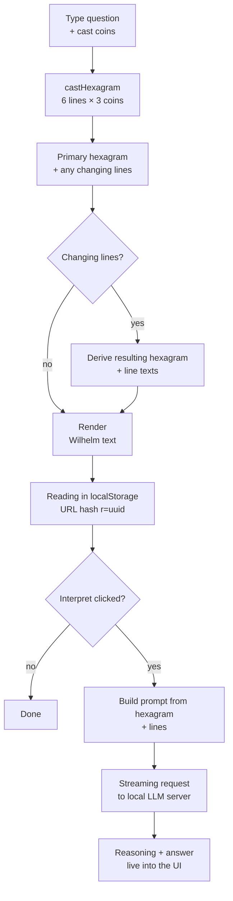

**🇬🇧 English** · [🇩🇪 Deutsch](README.de.md)

# Yijing Oracle

[](LICENSE)
[](LICENSE-DOCS)
[](https://codeberg.org/jkaindl/Yijing/releases)
[](https://codeberg.org/jkaindl/Yijing/commits/branch/main)
[](docs/MACOS-APP.md)
[](https://jkaindl.codeberg.page/Yijing/)
[](#why-no-build-pipeline)

A lean I Ching oracle as a static site with the Wilhelm translation and
optional AI interpretation via local LLM servers (Ollama, MLX, LM Studio,
vLLM, OpenClaw). Three-coin method, complete Wilhelm texts including all
changing lines, Chinese character with Pīnyīn, trigrams with reference
data. **Bilingual German / English** — UI and hexagram texts switchable
(the English is an independent translation of the Wilhelm original, kept
in Wilhelm's style, with classic I Ching vocabulary). Vanilla JavaScript,
no build step, no backend, offline-capable as a PWA.

<p align="center">
  <a href="https://jkaindl.codeberg.page/Yijing/">
    
  </a>
</p>

[](https://codeberg.org/jkaindl/Yijing/releases/download/v1.4.1/Yijing.dmg)
[](https://jkaindl.codeberg.page/Yijing/)

Open the disk image, drag “Yijing” into your Applications folder — done.
The app is **Developer ID-signed and Apple-notarized**, so it launches
right away, with no Gatekeeper warning. Background and the signing
pipeline: [`docs/MACOS-APP.md`](docs/MACOS-APP.md).

---

## Contents

- [Live demo](#live-demo)
- [Quick start](#quick-start)
- [As a macOS app](#as-a-macos-app)
- [Features](#features)
- [Language (German / English)](#language-german--english)
- [Local LLM connection](#local-llm-connection)
- [How a reading works](#how-a-reading-works)
- [Three-coin method](#three-coin-method)
- [Directory structure](#directory-structure)
- [Documentation](#documentation)
- [Release history](#release-history)
- [Contributing](#contributing)
- [Reporting security issues](#reporting-security-issues)
- [License](#license)
- [Sources](#sources)
- [Status](#status)

---

## Live demo

<https://jkaindl.codeberg.page/Yijing/> — works without any local setup
for casting a hexagram and reading the Wilhelm text. The AI interpretation
requires a locally running LLM server (Ollama or MLX), see
[Quick start](#quick-start).

On the first visit a service worker installs itself in the background —
after that the site runs fully offline. Via the browser’s “Install app”
button it lands as a PWA in the Dock or on the home screen.

## Quick start

```bash
git clone https://codeberg.org/jkaindl/Yijing.git yijing
cd yijing
./serve.sh
```

Opens `http://localhost:8765/web/index.html` automatically.

> Requirement: Python 3.9+. No npm dependencies, no build step, no
> backend.

## As a macOS app

For handing it to users without terminal experience, the oracle can be
bundled as a double-clickable macOS app:

```bash
./scripts/build-macos-app.sh
```

This produces `dist/Yijing.dmg` — a disk image in which `Yijing.app` is
dragged into the Applications folder. The app shows the oracle in its own
window, with no terminal and no browser. Build requirement: Xcode Command
Line Tools (`xcode-select --install`). Details:
[`docs/MACOS-APP.md`](docs/MACOS-APP.md).

## Features

- **Three-coin method** with the correct distribution (1/8 : 3/8 : 3/8 : 1/8)
- **Primary and resulting hexagram** for changing lines, with visual
  marking
- **Wilhelm translation** (1924, public domain): judgment, image, meaning,
  all six line texts with Confucius commentary
- **Chinese character + Pīnyīn** per hexagram
- **Trigrams** with family, nature, season, cardinal direction,
  associations
- **Image meditation** (atmospheric keywords) for 19 hexagrams
- **AI interpretation** via a local LLM server (Ollama, MLX, LM Studio,
  vLLM, OpenClaw) with streaming, reasoning control and Markdown
  rendering
- **History** of the last 20 readings in localStorage, individual
  readings shareable and restorable via URL hash
- **Export** as Markdown or print-friendly PDF
- **Offline-capable** — service worker; after the first visit the app
  loads and runs without internet. Installable as a PWA.
- **Theme switcher** — dark, light or automatic following the system
  setting
- **Keyboard operation** for casting, reset and settings

## Language (German / English)

The app starts in your browser’s language (`navigator.language`):
`en*` → English, everything else → German. Switchable in the settings
modal (⚙ → Language). The choice takes effect immediately on all UI
elements, the date format in the history, the Markdown export headers and
the default system prompt for the AI interpretation.

The English hexagram texts are an independent translation of the German
Wilhelm original (1924, public domain) in Wilhelm’s style: dignified,
contemplative, with the classic I Ching vocabulary from the English
standard literature (the superior man, the great man, the noble, the
abyss, the well, the receptive, the creative …) — comparable to Cary F.
Baynes’ 1950s translation, but in its own words. Translated with Claude
Opus 4.7, in parallel across eight subagents. Schema and generation
details: [`docs/DATA.md`](docs/DATA.md#english-variant-datahexagramsenjson).

## Local LLM connection

Clicking the ⚙ icon in the top left opens the settings modal. On first
launch the app automatically probes the typical local endpoints:

| Server | Example URL |
|---|---|
| Ollama | `http://localhost:11434` |
| MLX (`mlx_lm.server`) | `http://localhost:8080/v1` |
| LM Studio | `http://localhost:1234/v1` |

Additional endpoints can be added manually.

### CORS

The web app calls the LLM servers directly from the browser — both sides
must allow CORS. For Ollama on macOS:

```bash
launchctl setenv OLLAMA_ORIGINS "*"
# restart Ollama
```

MLX and LM Studio are open by default. Details and troubleshooting:
[`docs/LLM.md`](docs/LLM.md#cors-troubleshooting).

## How a reading works



Technical details: [`docs/ARCHITECTURE.md`](docs/ARCHITECTURE.md).

## Three-coin method

Three coins per line (yin = 0, yang = 1); the sum + 6 yields the line
value:

| Value | Meaning | Probability |
|---|---|---|
| 6 | changing yin (○) | 1/8 (12.5 %) |
| 7 | stable yang | 3/8 (37.5 %) |
| 8 | stable yin | 3/8 (37.5 %) |
| 9 | changing yang (○) | 1/8 (12.5 %) |

Resolving the changing lines into a resulting hexagram and the King Wen
mapping happens in the browser via a complete lookup table.

## Directory structure

```
yijing/
├── web/                       # frontend (HTML/CSS/JS, vanilla)
├── data/                      # 64 hexagrams + 8 trigrams as JSON
├── scripts/                   # build and dev-server scripts
├── docs/                      # architecture, data, LLM, development, macOS app
├── .gitea/                    # issue templates for Codeberg
├── _archiv/                   # earlier attempts — excluded via .gitignore
├── sw.js                      # service worker (offline caching)
├── AGENTS.md                  # conventions for AI coding sessions
├── CONTRIBUTING.md            # contribution notes
├── CHANGELOG.md               # version history
├── SECURITY.md                # security reports
├── LICENSE                    # AGPL-3.0-or-later (code)
├── LICENSE-DOCS               # CC BY-SA 4.0 (docs)
├── README.md                  # this file (English, canonical)
└── README.de.md               # German README
```

## Documentation

| File | Contents |
|---|---|
| [`docs/ARCHITECTURE.md`](docs/ARCHITECTURE.md) | Module layout, data flow, persistence |
| [`docs/DATA.md`](docs/DATA.md) | Schema of `hexagrams.json` and `trigrams.json` |
| [`docs/LLM.md`](docs/LLM.md) | LLM backends, reasoning modes, CORS troubleshooting |
| [`docs/DEVELOPMENT.md`](docs/DEVELOPMENT.md) | Development setup, tests, debugging, release process |
| [`docs/MACOS-APP.md`](docs/MACOS-APP.md) | Building the macOS app, bundle layout, distribution |
| [`AGENTS.md`](AGENTS.md) | Conventions for AI-driven sessions |
| [`CONTRIBUTING.md`](CONTRIBUTING.md) | Contribution notes, PR checklist, commit style |
| [`SECURITY.md`](SECURITY.md) | Security reports, threat model, scope |
| [`CHANGELOG.md`](CHANGELOG.md) | Version history (Keep a Changelog, SemVer) |

## Release history

Full notes per release: [`CHANGELOG.md`](CHANGELOG.md).

| Version | Date | Headline |
|---|---|---|
| [v1.4.1](https://codeberg.org/jkaindl/Yijing/releases/tag/v1.4.1) | 2026-06-01 | **Notarized macOS app** — the release DMG is now Developer ID-signed and Apple-notarized, so it launches with no Gatekeeper warning (the old “Open Anyway” / `xattr` workaround is gone). Opt-in signing pipeline in `build-macos-app.sh` (`YIJING_SIGN_IDENTITY` / `YIJING_NOTARY_PROFILE`); README, INSTALL and `docs/MACOS-APP.md` updated for macOS 15/26 Gatekeeper |
| [v1.4.0](https://codeberg.org/jkaindl/Yijing/releases/tag/v1.4.0) | 2026-06-01 | **Data correctness + gender-neutral edition + export repair** — Wilhelm texts re-sourced from Projekt-Gutenberg (filled the empty meanings, restored hexagram 2’s image, added footnotes and the all-lines-moving oracle for hexagrams 1 & 2, removed line-contamination from the image fields, fixed OCR glitches), a gender-neutral text variant on by default with a settings toggle to the verbatim 1924 wording (DE + EN), and a working Markdown/PDF export in the macOS app via a native WKWebView bridge with two PDF modes (print B/W and full-bleed app design) |
| [v1.3.0](https://codeberg.org/jkaindl/Yijing/releases/tag/v1.3.0) | 2026-05-28 | **UI polish + bilingual README** — visible language switcher in the footer, minimalist inline-SVG header icons (Lucide) instead of Unicode glyphs, two-state theme toggle with a state icon. README split into EN (canonical) + DE, app bundle version brought up to 1.3.0 |
| [v1.2.1](https://codeberg.org/jkaindl/Yijing/releases/tag/v1.2.1) | 2026-05-27 | **Patch release** — hero image + `og:image` for social previews, StaticServer connection limit, `serve.py` dead code removed, EN translation spot-check QA (君子 vocabulary consistent as “noble one”, hex 11 + 49 polish) |
| [v1.2.0](https://codeberg.org/jkaindl/Yijing/releases/tag/v1.2.0) | 2026-05-27 | **Bilingual DE/EN** — i18n layer for the entire UI (settings toggle, browser language as default), an independent Wilhelm→EN translation of all 64 hexagrams in Wilhelm’s style. Plus pages-sync script, King Wen sanity test, Open Graph tags, `.editorconfig` |
| [v1.1.1](https://codeberg.org/jkaindl/Yijing/releases/tag/v1.1.1) | 2026-05-25 | **Audit sweep patch** — stream-reader lock fix, HTML-escape hardening, NWListener race removed, path-traversal guard, deterministic data build |
| [v1.1](https://codeberg.org/jkaindl/Yijing/releases/tag/v1.1) | 2026-05-24 | **macOS app without Python** — Swift-internal static server, no more CLT dependency, smaller DMG |
| [v1.0](https://codeberg.org/jkaindl/Yijing/releases/tag/v1.0) | 2026-05-22 | **Initial release** — three-coin method, Wilhelm texts, LLM adapter (Ollama/OpenAI-compatible), PWA, service worker, macOS app build |

## Contributing

Issues, PRs and translations are welcome. Please read
[`CONTRIBUTING.md`](CONTRIBUTING.md) first — there are clear architectural
guardrails (no framework, no build step, no TypeScript). For bug reports
and feature requests there are templates under
[Codeberg → New issue](https://codeberg.org/jkaindl/Yijing/issues/new/choose).

### Why no build pipeline?

Yijing is the seventh attempt after six discarded predecessors (see
`_archiv/`). All earlier attempts foundered in structural over-engineering
— notebook workflows, Pydantic layers, FastAPI wrappers. This attempt is
deliberately different: **vanilla ES modules + native
`<script type="module">` import + static JSON**. When the app grows we
split code; we do not introduce a toolchain.

## Reporting security issues

Please do **not** post security-relevant problems publicly as an issue.
Instead see [`SECURITY.md`](SECURITY.md) — a short path via Codeberg DM or
email.

## License

- **Code:** GNU Affero General Public License v3.0 or later —
  [AGPL-3.0-or-later](LICENSE).
- **Documentation** (`README.md`, `README.de.md`, `CHANGELOG.md`,
  `CONTRIBUTING.md`, `SECURITY.md`, `AGENTS.md`, `docs/`): Creative
  Commons Attribution-ShareAlike 4.0 International —
  [CC BY-SA 4.0](LICENSE-DOCS).
- **Wilhelm translation** in `data/hexagrams.json`: public domain
  (Wilhelm † 1930; public domain in Germany since 2001). When reusing,
  please credit Richard Wilhelm as the source.

### Why AGPL?

This license choice is not incidental. The AGPL is the legal mechanism
that protects a particular logic: contributions to the commons stay in
the commons — even if someone tries to commercialize them via a network
service.

Unlike permissive licenses (MIT, Apache) or file-level copyleft (MPL),
the AGPL’s network clause (§13) prevents this code from becoming the
foundation of closed, commercially controlled infrastructure. Whoever
runs a modified variant as a network service must make the source code
available to the users of that service.

This is a deliberate decision against maximum distribution and in favor
of theoretical coherence: what was published as a contribution to the
commons should stay in the commons — even if that limits adoption by
actors whose business model rests on re-privatizing those contributions.

yijing has no external code dependencies — no npm, no build step, no
third-party JS libraries. The AGPL obligations apply fully to the shipped
JavaScript code, which is directly inspectable in the browser anyway.
External LLM servers (Ollama, MLX) are called via HTTP API — no code
linking; their licenses apply separately.

## Sources

- Wilhelm, Richard: *I Ging — Das Buch der Wandlungen*, Diederichs, 1924
- Trigram reference data and Chinese designations from standard
  literature and Chinese original sources

## Status

A hobby project after six discarded attempts — see `_archiv/`. This
attempt is deliberately different: lean, dependency-free, local. Works
fully in the browser; the AI connection is optional and intended
exclusively for local servers.

---

<sub>Repository: <https://codeberg.org/jkaindl/Yijing> · Live:
<https://jkaindl.codeberg.page/Yijing/> · Issues:
<https://codeberg.org/jkaindl/Yijing/issues> · Releases:
<https://codeberg.org/jkaindl/Yijing/releases></sub>
