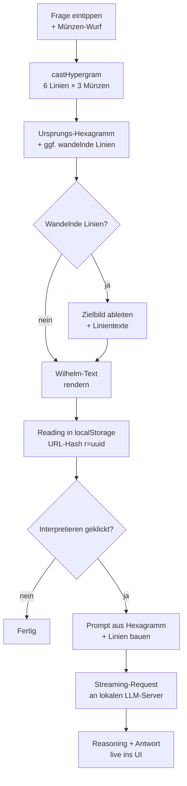

# Yijing Orakel

[](LICENSE)
[](LICENSE-DOCS)
[](https://codeberg.org/jkaindl/Yijing/releases)
[](https://codeberg.org/jkaindl/Yijing/commits/branch/main)
[](docs/MACOS-APP.md)
[](https://jkaindl.codeberg.page/Yijing/)
[](#warum-keine-build-pipeline)

Ein schlankes I-Ging-Orakel als Static-Site mit Wilhelm-Übersetzung und
optionaler KI-Deutung über lokale LLM-Server (Ollama, MLX, LM Studio,
vLLM, OpenClaw). Drei-Münzen-Methode, vollständige Wilhelm-Texte
inklusive aller wandelnden Linien, chinesisches Schrift­zeichen mit
Pīnyīn, Trigramme mit Stammdaten. **Zweisprachig Deutsch / English** —
UI und Hexagramm-Texte umschaltbar (Englisch ist eine eigene
Übersetzung des Wilhelm-Originals, im Wilhelm-Stil gehalten, klassische
I-Ching-Vokabeln). Vanilla JavaScript, kein Build-Step, kein Backend,
offline-fähig als PWA.

[](https://codeberg.org/jkaindl/Yijing/releases/download/v1.2.0/Yijing.dmg)
[](https://jkaindl.codeberg.page/Yijing/)

Disk-Image öffnen, „Yijing" in den Programme-Ordner ziehen — fertig.

> **Beim ersten Start meldet macOS „Apple konnte die App nicht prüfen".**
> Das ist normal (Hobbyprojekt ohne Apple-Notarisierung) und in zwei
> Minuten gelöst:
>
> 1. Auf die Warnung **„Fertig"** klicken (nicht „In den Papierkorb"!).
> 2. **Apple-Menü → Systemeinstellungen → Datenschutz & Sicherheit**.
> 3. Ganz nach unten scrollen → **„Trotzdem öffnen"** neben dem
>    Yijing-Hinweis → mit Passwort/Touch ID bestätigen.
> 4. Letzter Dialog: nochmal **„Trotzdem öffnen"**.
>
> Beim zweiten Start ist nichts mehr nötig. Falls der „Trotzdem öffnen"-
> Knopf fehlt (neuere macOS-Versionen), im Terminal:
> `xattr -dr com.apple.quarantine /Applications/Yijing.app`. Details und
> Hintergrund: [`docs/MACOS-APP.md`](docs/MACOS-APP.md).

---

## Inhalt

- [Live-Demo](#live-demo)
- [Schnellstart](#schnellstart)
- [Als macOS-App](#als-macos-app)
- [Features](#features)
- [Sprache (Deutsch / English)](#sprache-deutsch--english)
- [Lokale LLM-Anbindung](#lokale-llm-anbindung)
- [Wie ein Wurf abläuft](#wie-ein-wurf-abläuft)
- [Drei-Münzen-Methode](#drei-münzen-methode)
- [Verzeichnisstruktur](#verzeichnisstruktur)
- [Dokumentation](#dokumentation)
- [Release-Historie](#release-historie)
- [Mitmachen](#mitmachen)
- [Sicherheit melden](#sicherheit-melden)
- [Lizenz](#lizenz)
- [Quellen](#quellen)
- [Status](#status)

---

## Live-Demo

<https://jkaindl.codeberg.page/Yijing/> — funktioniert ohne lokales
Setup für Hexagramm-Wurf und Wilhelm-Text. Die KI-Deutung erfordert
einen lokal laufenden LLM-Server (Ollama oder MLX), siehe
[Schnellstart](#schnellstart).

Beim ersten Besuch installiert sich der Service Worker im Hintergrund
— danach läuft die Seite vollständig offline. Über den
„App-installieren"-Knopf des Browsers landet sie als PWA im Dock oder
auf dem Homescreen.

## Schnellstart

```bash
git clone https://codeberg.org/jkaindl/Yijing.git yijing
cd yijing
./serve.sh
```

Öffnet `http://localhost:8765/web/index.html` automatisch.

> Voraussetzung: Python 3.9+. Keine npm-Dependencies, kein Build-Step,
> kein Backend.

## Als macOS-App

Für die Weitergabe an Nutzer ohne Terminal-Erfahrung lässt sich das
Orakel als doppelklickbare macOS-App bündeln:

```bash
./scripts/build-macos-app.sh
```

Das erzeugt `dist/Yijing.dmg` — ein Disk-Image, in dem die `Yijing.app`
per Drag & Drop in den Programme-Ordner gezogen wird. Die App zeigt das
Orakel in einem eigenen Fenster, ganz ohne Terminal und ohne Browser.
Voraussetzung zum Bauen: Xcode Command Line Tools
(`xcode-select --install`). Details: [`docs/MACOS-APP.md`](docs/MACOS-APP.md).

## Features

- **Drei-Münzen-Methode** mit korrekter Verteilung (1/8 : 3/8 : 3/8 : 1/8)
- **Ursprungs- und Zielbild** bei wandelnden Linien, mit visueller
  Markierung
- **Wilhelm-Übersetzung** (1924, gemeinfrei): Urteil, Bild, Bedeutung,
  alle sechs Linientexte mit Konfuzius-Kommentar
- **Chinesisches Schriftzeichen + Pīnyīn** pro Hexagramm
- **Trigramme** mit Familie, Natur, Jahreszeit, Himmelsrichtung,
  Assoziationen
- **Bildmeditation** (atmosphärische Stichworte) für 19 Hexagramme
- **KI-Interpretation** via lokalem LLM-Server (Ollama, MLX, LM Studio,
  vLLM, OpenClaw) mit Streaming, Reasoning-Steuerung und Markdown-
  Rendering
- **Verlauf** der letzten 20 Würfe in localStorage, einzelne Würfe via
  URL-Hash teilbar und wiederherstellbar
- **Export** als Markdown oder druckfreundliches PDF
- **Offline-fähig** — Service Worker; nach dem ersten Besuch lädt und
  läuft die App ohne Internet. Als PWA installierbar.
- **Theme-Umschalter** — Dark, Light oder automatisch nach
  System­einstellung
- **Tastatur-Bedienung** für Wurf, Reset und Settings

## Sprache (Deutsch / English)

Die App startet in der Sprache deines Browsers (`navigator.language`):
`en*` → English, alles andere → Deutsch. Umschaltbar im Settings-Modal
(⚙ → Sprache). Die Auswahl wirkt sofort auf alle UI-Elemente, das
Datumsformat im Verlauf, die Markdown-Export-Header und den Default-
System-Prompt für die KI-Interpretation.

Die englischen Hexagramm-Texte sind eine eigene Übersetzung des
deutschen Wilhelm-Originals (1924, gemeinfrei) im Wilhelm-Stil:
würdevoll, kontemplativ, mit den klassischen I-Ching-Vokabeln aus der
englischen Standardliteratur (the superior man, the great man, the
noble, the abyss, the well, the receptive, the creative …) —
vergleichbar mit Cary F. Baynes' 1950er-Übersetzung, aber in eigenen
Worten. Übersetzt mit Claude Opus 4.7, parallel über acht Subagenten.
Schema und Generierungs-Details: [`docs/DATA.md`](docs/DATA.md#englische-variante-datahexagramsenjson).

## Lokale LLM-Anbindung

Klick auf das ⚙-Symbol oben links öffnet das Settings-Modal. Beim ersten
Start probiert die App automatisch die typischen lokalen Endpunkte:

| Server | URL-Beispiel |
|---|---|
| Ollama | `http://localhost:11434` |
| MLX (`mlx_lm.server`) | `http://localhost:8080/v1` |
| LM Studio | `http://localhost:1234/v1` |

Weitere Endpunkte lassen sich manuell hinzufügen.

### CORS

Die Web-App ruft die LLM-Server direkt aus dem Browser auf — beide Seiten
müssen CORS erlauben. Für Ollama auf macOS:

```bash
launchctl setenv OLLAMA_ORIGINS "*"
# Ollama neu starten
```

MLX und LM Studio sind standardmäßig offen. Details und Fehlersuche:
[`docs/LLM.md`](docs/LLM.md#cors-fehlersuche).

## Wie ein Wurf abläuft



Technische Details: [`docs/ARCHITECTURE.md`](docs/ARCHITECTURE.md).

## Drei-Münzen-Methode

Pro Linie drei Münzen (Yin = 0, Yang = 1), Summe + 6 ergibt den
Linienwert:

| Wert | Bedeutung | Wahrscheinlichkeit |
|---|---|---|
| 6 | wandelndes Yin (○) | 1/8 (12,5 %) |
| 7 | festes Yang | 3/8 (37,5 %) |
| 8 | festes Yin | 3/8 (37,5 %) |
| 9 | wandelndes Yang (○) | 1/8 (12,5 %) |

Die Auflösung wandelnder Linien zu einem Zielbild und die King-Wen-
Zuordnung erfolgt im Browser über eine vollständige Lookup-Tabelle.

## Verzeichnisstruktur

```
yijing/
├── web/                       # Frontend (HTML/CSS/JS, vanilla)
├── data/                      # 64 Hexagramme + 8 Trigramme als JSON
├── scripts/                   # Build- und Dev-Server-Skripte
├── docs/                      # Architektur, Daten, LLM, Entwicklung, macOS-App
├── .gitea/                    # Issue-Vorlagen für Codeberg
├── _archiv/                   # alte Anläufe — per .gitignore ausgeschlossen
├── sw.js                      # Service Worker (Offline-Caching)
├── AGENTS.md                  # Konventionen für KI-Coding-Sessions
├── CONTRIBUTING.md            # Beitragshinweise
├── CHANGELOG.md               # Versionshistorie
├── SECURITY.md                # Sicherheits-Meldungen
├── LICENSE                    # AGPL-3.0-or-later (Code)
├── LICENSE-DOCS               # CC BY-SA 4.0 (Doku)
└── README.md                  # diese Datei
```

## Dokumentation

| Datei | Inhalt |
|---|---|
| [`docs/ARCHITECTURE.md`](docs/ARCHITECTURE.md) | Modulaufbau, Datenfluss, Persistenz |
| [`docs/DATA.md`](docs/DATA.md) | Schema von `hexagrams.json` und `trigrams.json` |
| [`docs/LLM.md`](docs/LLM.md) | LLM-Backends, Reasoning-Modi, CORS-Fehlersuche |
| [`docs/DEVELOPMENT.md`](docs/DEVELOPMENT.md) | Entwicklungs-Setup, Tests, Debugging, Release-Prozess |
| [`docs/MACOS-APP.md`](docs/MACOS-APP.md) | macOS-App bauen, Bundle-Aufbau, Weitergabe |
| [`AGENTS.md`](AGENTS.md) | Konventionen für KI-getriebene Sessions |
| [`CONTRIBUTING.md`](CONTRIBUTING.md) | Beitragshinweise, PR-Checkliste, Commit-Stil |
| [`SECURITY.md`](SECURITY.md) | Sicherheits-Meldungen, Threat-Model, Scope |
| [`CHANGELOG.md`](CHANGELOG.md) | Versionshistorie (Keep a Changelog, SemVer) |

## Release-Historie

Vollständige Notes pro Release: [`CHANGELOG.md`](CHANGELOG.md).

| Version | Datum | Headline |
|---|---|---|
| [v1.2.0](https://codeberg.org/jkaindl/Yijing/releases/tag/v1.2.0) | 2026-05-27 | **Zweisprachig DE/EN** — i18n-Layer für die komplette UI (Settings-Toggle, Browser-Sprache als Default), eigene Wilhelm→EN-Übersetzung aller 64 Hexagramme im Wilhelm-Stil. Plus Pages-Sync-Skript, King-Wen-Sanity-Test, Open-Graph-Tags, `.editorconfig` |
| [v1.1.1](https://codeberg.org/jkaindl/Yijing/releases/tag/v1.1.1) | 2026-05-25 | **Audit-Sweep-Patch** — Stream-Reader-Lock-Fix, HTML-Escape-Härtung, NWListener-Race weg, Pfad-Traversal-Guard, deterministisches Daten-Build |
| [v1.1](https://codeberg.org/jkaindl/Yijing/releases/tag/v1.1) | 2026-05-24 | **macOS-App ohne Python** — Swift-interner Static-Server, keine CLT-Abhängigkeit mehr, kleineres DMG |
| [v1.0](https://codeberg.org/jkaindl/Yijing/releases/tag/v1.0) | 2026-05-22 | **Initial Release** — Drei-Münzen-Methode, Wilhelm-Texte, LLM-Adapter (Ollama/OpenAI-kompatibel), PWA, Service Worker, macOS-App-Build |

## Mitmachen

Issues, PRs und Übersetzungen sind willkommen. Bitte vorher
[`CONTRIBUTING.md`](CONTRIBUTING.md) lesen — es gibt klare
Architektur-Leitplanken (kein Framework, kein Build-Step, kein TypeScript).
Für Bug-Reports und Feature-Requests gibt es Vorlagen unter
[Codeberg → Neue Issue](https://codeberg.org/jkaindl/Yijing/issues/new/choose).

### Warum keine Build-Pipeline?

Yijing ist der siebte Anlauf nach sechs verworfenen Vorgängern (siehe
`_archiv/`). Alle früheren Anläufe sind in strukturellem Over-Engineering
versandet — Notebook-Workflows, Pydantic-Schichten, FastAPI-Wrapper.
Dieser Anlauf ist absichtlich anders: **vanilla ES-Module + nativer
`<script type="module">`-Import + statisches JSON**. Wenn die App
wächst, splitten wir Code; wir führen kein Toolchain ein.

## Sicherheit melden

Sicherheitsrelevante Probleme bitte **nicht öffentlich als Issue
posten**. Stattdessen siehe [`SECURITY.md`](SECURITY.md) — kurzer Weg
über Codeberg-DM oder E-Mail.

## Lizenz

- **Code:** GNU Affero General Public License v3.0 oder später —
  [AGPL-3.0-or-later](LICENSE).
- **Dokumentation** (`README.md`, `CHANGELOG.md`, `CONTRIBUTING.md`,
  `SECURITY.md`, `AGENTS.md`, `docs/`): Creative Commons Attribution-
  ShareAlike 4.0 International — [CC BY-SA 4.0](LICENSE-DOCS).
- **Wilhelm-Übersetzung** in `data/hexagrams.json`: gemeinfrei
  (Wilhelm † 1930; Gemeinfreiheit in Deutschland seit 2001). Bei
  Weiterverwendung bitte Richard Wilhelm als Quelle nennen.

### Warum AGPL?

Diese Lizenzwahl ist nicht zufällig. AGPL ist der rechtliche
Mechanismus, der eine bestimmte Logik schützt: Beiträge zur Allmende
bleiben in der Allmende — auch wenn jemand versucht, sie über einen
Netzwerkdienst zu kommerzialisieren.

Anders als permissive Lizenzen (MIT, Apache) oder file-level Copyleft
(MPL) verhindert die Network-Klausel der AGPL (§13), dass dieser Code
zur Grundlage geschlossener, kommerziell kontrollierter Infrastruktur
wird. Wer eine modifizierte Variante als Netzwerkdienst betreibt, muss
den Quellcode für die Nutzer dieses Dienstes verfügbar machen.

Das ist eine bewusste Entscheidung gegen maximale Verbreitung und für
theoretische Kohärenz: Was als Beitrag zur Allmende veröffentlicht
wurde, sollte in der Allmende bleiben — auch wenn das die Adoption
durch Akteure einschränkt, deren Geschäftsmodell auf der
Re-Privatisierung dieser Beiträge basiert.

yijing hat keine externen Code-Abhängigkeiten — kein npm, kein
Build-Step, keine Drittanbieter-JS-Bibliotheken. Die AGPL-Verpflichtungen
gelten vollständig auf den ausgelieferten JavaScript-Code, der im
Browser ohnehin direkt einsehbar ist. Externe LLM-Server (Ollama, MLX)
werden via HTTP-API aufgerufen — kein Code-Linking; deren Lizenzen
wirken separat.

## Quellen

- Wilhelm, Richard: *I Ging — Das Buch der Wandlungen*, Diederichs, 1924
- Trigramm-Stammdaten und chinesische Bezeichnungen aus
  Standardliteratur und chinesischen Originalquellen

## Status

Hobbyprojekt nach sechs verworfenen Anläufen — siehe `_archiv/`. Dieser
Anlauf ist absichtlich anders: schlank, abhängigkeitsfrei, lokal.
Funktioniert vollständig im Browser; die KI-Anbindung ist optional und
ausschließlich für lokale Server gedacht.

---

<sub>Repository: <https://codeberg.org/jkaindl/Yijing> · Live:
<https://jkaindl.codeberg.page/Yijing/> · Issues:
<https://codeberg.org/jkaindl/Yijing/issues> · Releases:
<https://codeberg.org/jkaindl/Yijing/releases></sub>
